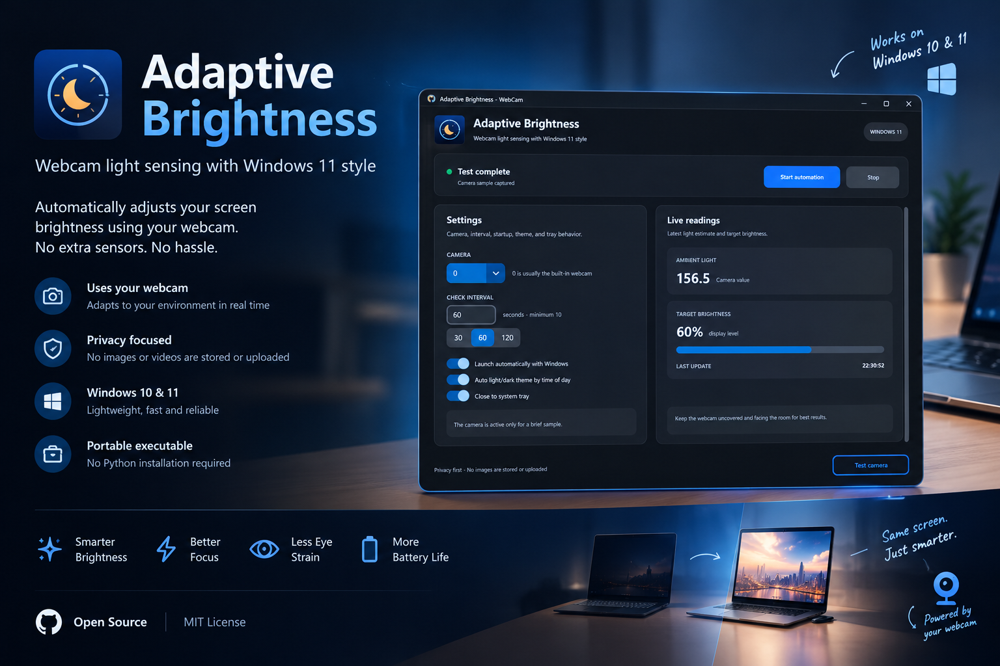

# Adaptive Brightness Webcam

<p align="center">
  
</p>

<p align="center">
  <strong>روشنایی راحت صفحه، خودکار و متناسب با نور اتاق شما.</strong><br>
  برنامه‌ای سبک برای ویندوز که نور محیط را با وب‌کم می‌سنجد و روشنایی نمایشگر لپ‌تاپ را با آن هماهنگ می‌کند — و هر بار روی خودِ نمایشگر راستی‌آزمایی می‌کند.
</p>

<p align="center">
  <a href="https://github.com/Arman-Kohan/adaptive-brightness-webcam/releases/tag/v1.1.0"></a>
  <a href="https://github.com/Arman-Kohan/adaptive-brightness-webcam/actions/workflows/build-check.yml"></a>
  
  
  <a href="LICENSE"></a>
</p>

<p align="center">
  <a href="README.md">🇬🇧 Read this in English</a>
</p>

---

## معرفی

بیشتر لپ‌تاپ‌ها روشنایی را فقط دستی تنظیم می‌کنند. Adaptive Brightness Webcam نور اطراف شما را از طریق وب‌کم داخلی زیر نظر می‌گیرد و با تغییر نور اتاق — روشن یا خاموش شدن چراغ‌ها، کم‌شدن نور روز، یا روشن کردن یک چراغ در غروب — صفحه را در سطحی راحت نگه می‌دارد.

این برنامه برای **آرام و قابل‌اعتماد** بودن طراحی شده است:

- وب‌کم فقط برای یک اندازه‌گیری کوتاه بیدار می‌شود و دوباره خاموش می‌شود؛ هرگز باز نگه داشته نمی‌شود.
- تغییرات روشنایی پالایش، تأیید و به‌نرمی اعمال می‌شوند، پس صفحه هرگز نوسان و سوسو ندارد.
- هر تغییر روشنایی **از طریق WMI اعمال و از خود نمایشگر بازخوانی** می‌شود؛ یعنی آنچه برنامه گزارش می‌کند، همان چیزی است که پنل واقعاً نشان می‌دهد.

## قابلیت‌های کلیدی

- **حالت Smart Adaptive** — زمان‌بندی کاملاً خودکار اندازه‌گیری: بررسی‌های پی‌درپی هنگام تغییر نور، و بررسی‌های پراکنده (تا هر ۲ دقیقه یک بار) در اتاق پایدار. هیچ تنظیم فاصله‌ای برای دست‌کاری وجود ندارد.
- **ضبط نوبتی وب‌کم** — برای هر بررسی فقط یک چرخه کنترل‌شده: باز شدن، دور ریختن فریم‌های گرم‌شدن تا تثبیت نوردهی خودکار، ضبط، و رهاسازی. چراغ وب‌کم بین بررسی‌ها خاموش است.
- **کنترل روشنایی ویندوز با راستی‌آزمایی** — ‏`WmiSetBrightness` از طریق WMI (همان سازوکار لغزنده روشنایی ویندوز) همراه با بازخوانی فوری، تلاش مجدد با مکث پلکانی، و ردیابی صادقانه سه وضعیت «درخواست‌شده / اعمال‌شده / تأییدشده».
- **منحنی آسایش کالیبره‌شده در میدان** — طی چند دور آزمون واقعی روی سخت‌افزار واقعی تنظیم شده و جبران صحنه‌اش سقف دارد تا اتاق‌های روشن بیش از حد نروند.
- **دروازه ضدسوسو** — دوره تثبیت پس از شروع، ناحیه مرده برای تغییرات ناچیز، تأیید برای تغییرات متوسط، و محدودیت نرخ و گام.
- **تنظیمات ماندگار** — دوربین، حالت، فاصله، تم و ترجیحات سینی سیستم پس از راه‌اندازی مجدد برنامه و ویندوز باقی می‌مانند.
- **سینی سیستم (System Tray)** — بی‌سروصدا در سینی سیستم می‌نشیند و کنترل سریع دارد؛ اجرای خودکار با ویندوز هم اختیاری است.
- **حریم خصوصی در طراحی** — فریم‌ها فقط در حافظه پردازش می‌شوند. هیچ‌چیز ضبط، ذخیره یا جایی ارسال نمی‌شود. بدون حساب کاربری، بدون شبکه، بدون تله‌متری.

## دانلود و نصب

1. به [**نسخه v1.1.0**](https://github.com/Arman-Kohan/adaptive-brightness-webcam/releases/tag/v1.1.0) بروید.
2. یکی از این دو را دانلود کنید:
   - ‎`AdaptiveBrightnessWebcam.exe`‎ — برنامه مستقل، یا
   - ‎`AdaptiveBrightnessWebcam-Windows.zip`‎ — همان فایل اجرایی همراه با این راهنما و آیکن برنامه.
3. فایل `AdaptiveBrightnessWebcam.exe` را اجرا کنید. چیزی برای نصب وجود ندارد: نه پایتون لازم است، نه وابستگی، نه دسترسی مدیر.

> **هشدار SmartScreen ویندوز:** فایل اجرایی امضای دیجیتال ندارد، پس ویندوز ممکن است در اولین اجرا هشدار نشان دهد. گزینه **More info ← Run anyway** را بزنید. این رفتار برای بیلدهای متن‌بازِ بدون امضا طبیعی است؛ می‌توانید فایل اجرایی را خودتان از سورس بسازید (بخش [توسعه](#توسعه)).

ارتقا از نسخه قدیمی‌تر: کافی است فایل `.exe` قدیمی را با فایل جدید جایگزین کنید؛ تنظیمات‌تان حفظ می‌شود (در ادامه توضیح داده شده). اگر فایل جدید در پوشه دیگری است و از «اجرا با ویندوز» استفاده می‌کنید، آن گزینه را یک بار خاموش و روشن کنید تا ویندوز به مسیر جدید اشاره کند.

## اجرای اول

1. **دوربین را انتخاب کنید** — معمولاً `0` همان وب‌کم داخلی است.
2. روی **Test camera** کلیک کنید. باید یک خوانش نور محیط و روشنایی متناظر با آن را ببینید.
3. حالت را روی **Smart Adaptive** بگذارید و **Start automation** را بزنید.

تنظیمات‌تان به‌صورت خودکار در ‎`%APPDATA%\Adaptive Brightness Webcam\settings.json`‎ ذخیره و در اجرای بعدی — حتی پس از راه‌اندازی مجدد ویندوز — بازیابی می‌شود. فایل تنظیمات خراب یا قدیمی هم به‌خوبی مدیریت می‌شود: مقادیر نامعتبر فیلدبه‌فیلد به پیش‌فرض برمی‌گردند و انتخاب‌های معتبر شما هرگز هنگام شروع بازنویسی نمی‌شوند.

## نحوه کار

هر چرخه اندازه‌گیری:

1. وب‌کم را باز می‌کند و فریم‌های اول را تا تثبیت نوردهی خودکار دور می‌ریزد تا هرگز به حسگرِ ناپایدار اعتماد نشود.
2. ‎۵ فریم می‌گیرد و هرکدام را با آمار مقاوم (میانه، صدک‌ها، هایلایت‌ها، کسر تاریکی) خلاصه می‌کند تا در برابر خیرگی و داده‌های پرت مقاوم باشد.
3. تغییرات نوردهی خودکار دوربین را جبران می‌کند و سپس برآورد نور محیط را با منحنی کالیبراسیون به روشنایی هدف تبدیل می‌کند.
4. برای اتاق‌های پرکنتراست (مثلاً پنجره روشن پشت یک میز تاریک‌تر) جبران صحنه محدود اعمال می‌کند.
5. نتیجه را هموار می‌کند (EMA)، تغییرات ناچیز را حذف می‌کند (ناحیه مرده و هیسترزیس) و از دروازه ضدسوسو عبور می‌دهد.
6. تغییر را از طریق WMI روی نمایشگر اعمال می‌کند — تغییرات بزرگ به‌تدریج و پلکانی — و **پنل را بازخوانی می‌کند تا مطمئن شود** سطح جدید واقعاً اعمال شده است.
7. وب‌کم را بلافاصله رها می‌کند. دوربین تا بررسی زمان‌بندی‌شده بعدی خاموش می‌ماند.

### زمان‌بندی Smart Adaptive

حالت Smart Adaptive خودش تصمیم می‌گیرد *کی* اندازه بگیرد. یک سیگنال هموارشده نور، یک برآورد مقاوم از نویز و یک برآورد روند را دنبال می‌کند و آن‌ها را با بازخوردِ فاصله روشنایی فعلی از هدف ترکیب می‌کند:

| رفتار اتاق | پاسخ زمان‌بندی |
| --- | --- |
| تغییر سریع و بزرگ نور | فاصله به کف ۵ ثانیه نزدیک می‌شود و تا وقتی تغییر در چند نمونه پیاپی تأیید شود، سریع می‌ماند |
| تغییر تدریجی (غروب، کم‌نور شدن چراغ) | فاصله به‌اعتدال کم می‌شود (×۰٫۶) |
| نور پایدار | فاصله رشد می‌کند (×۱٫۴) تا سقف ۲ دقیقه — یعنی حدود ۴۰ بار فعال‌شدن دوربین در ساعت، به‌جای ۷۲۰ بار با فاصله ثابت ۵ ثانیه‌ای |

فاصله‌ها در داخل برنامه بین **۵ تا ۱۲۰ ثانیه** محدودند و قابل تنظیم توسط کاربر نیستند — هیچ تنظیم حداقل/حداکثری وجود ندارد که اشتباه مقدار بگیرد. در اتاق پایدار این بده‌بستان آگاهانه است: تغییر ناگهانی نور ممکن است تا حدود ۲ دقیقه دیرتر دیده شود، در عوض دوربین تقریباً هیچ‌وقت روشن نیست. هنگام کار با باتری، حالت *Fixed Interval* فاصله‌اش را بیشتر هم می‌کند (×۲٫۵، حداقل ۵ دقیقه).

### کالیبراسیون

منحنی تبدیل نور محیط به روشنایی، بازه اندازه‌گیری ۸ تا ۲۴۰ را به روشنایی ۱۰ تا ۷۵ درصد نگاشت می‌کند. این منحنی بر اساس نقاط آسایشی کالیبره شده که طی چند نسخه روی سخت‌افزار واقعی جمع‌آوری شده‌اند:

| خوانش نور محیط | ۲۰ | ۴۰ | ۱۰۰ | ۱۵۰ | ۱۷۷٫۸ | ۲۰۰ | ۲۴۰ |
| --- | --- | --- | --- | --- | --- | --- | --- |
| روشنایی صفحه | ۱۲٪ | ۱۵٪ | ۳۰٪ | ۴۵٪ | ۵۴٪ | ۶۱٪ | ۷۵٪ |

دو سازوکار مراقب‌اند که هدف *مؤثر* نهایی به این منحنی وفادار بماند:

- **جبران صحنه سقف دارد.** صحنه‌های پرکنتراست می‌توانند نور مؤثر را از خوانش خام بالاتر ببرند، اما مجموع افزایشِ همه تعدیل‌گرها (جبران صحنه، جبران صحنه تاریک، جبران نوردهی) بر حسب واحد روشنایی محدود است — تا ۱۵ واحد در نور کم و متوسط، و در نورهای بالا به‌تدریج **صفر** می‌شود، چون اندازه‌گیریِ از قبل روشن نیازی به کمک ندارد.
- **راستی‌آزمایی حلقه را می‌بندد.** یک هدف فقط وقتی «اعمال‌شده» گزارش می‌شود که بازخوانی نمایشگر آن را تأیید کند (در ادامه).

<details>
<summary>جزئیات دروازه ضدسوسو</summary>

در حالت Smart Adaptive هر روشنایی پیشنهادی از `BrightnessChangeGate` هم می‌گذرد:

- ‎۳ نمونه اول پس از شروع فقط برای تثبیت‌اند؛ چیزی اعمال نمی‌شود.
- تغییرات کوچک‌تر از ۴ واحد نادیده گرفته می‌شوند (ناحیه مرده).
- تغییرات متوسط به ۲ نمونه پیاپیِ تأییدکننده نیاز دارند.
- تغییرات پیاپی محدودیت نرخ (۲۰ ثانیه) و گام (۲۰ واحد) دارند.
- تغییرات بزرگ (۱۲ واحد یا بیشتر، مثلاً روشن شدن چراغ‌ها) بی‌درنگ اعمال می‌شوند.
</details>

### کنترل روشنایی ویندوز و راستی‌آزمایی

روشنایی از طریق **WMI** تنظیم می‌شود — ‏`WmiMonitorBrightnessMethods.WmiSetBrightness`، همان رابطی که لغزنده روشنایی ویندوز برای نمایشگر داخلی لپ‌تاپ استفاده می‌کند — و در همان عملیات از طریق `WmiMonitorBrightness.CurrentBrightness` بازخوانی می‌شود.

لایه اعمال (`BrightnessApplier`) سه وضعیت را جدا نگه می‌دارد: **درخواست‌شده**، **اعمال‌شده** (API پذیرفته) و **تأییدشده** (بازخوانی مطابق است). رفتار آن:

- نتیجه‌ها با یکی از این برچسب‌ها گزارش می‌شوند: `verified` ‏(تأییدشده)، `applied_unverified` ‏(API پذیرفته اما دستگاه بازخوانی ندارد) یا `failed` ‏(ناموفق) — هرگز موفقیت به‌صورت پیش‌فرض فرض نمی‌شود.
- خطاهای گذرا و ناهمخوانی بازخوانی تا ۳ بار با مکث پلکانی (۰٫۳ و ۰٫۶ ثانیه) دوباره تلاش می‌شوند.
- همه اعمال روی یک قفل واحد سریال می‌شوند و درخواست‌های جدیدتر، درخواست‌های در حال اجرای قدیمی‌تر را کنار می‌زنند؛ پس اندازه‌گیری‌های سریع نمی‌توانند دستورهای متضاد بسازند و رمپ‌ها به‌جای تحمیل خودشان، متوقف می‌شوند.
- اگر کلاس‌های روشنایی WMI روی دستگاهی وجود نداشته باشند، روش قدیمی `powercfg` ‏(پلن انرژی) به‌عنوان جایگزین استفاده می‌شود و نتیجه‌اش «تأییدنشده» برچسب می‌خورد.
- نشانگر پیشرفت رابط کاربری، روشنایی **اعمال‌شده** را نشان می‌دهد و اگر تغییری اعمال نشود، برنامه صراحتاً می‌گوید («Brightness not applied»)، به‌جای اینکه مقداری را نشان دهد که صفحه ندارد.

هر تلاش در لاگ تشخیصی به‌صورت یک خط ساخت‌یافته نوشته می‌شود، مثلاً:

```
brightness_apply target=54 previous=48 method=wmi attempt=1 status=accepted readback=54 result=verified
```

## مقایسه Fixed در برابر Smart Adaptive

| | Fixed Interval | Smart Adaptive |
| --- | --- | --- |
| زمان اندازه‌گیری | هر فاصله‌ای که شما تعیین می‌کنید (۳۰ ثانیه یا بیشتر) | خودکار، ۵ تا ۱۲۰ ثانیه بر اساس پایداری نور |
| استفاده از دوربین | یک ضبط کوتاه در هر فاصله | یک ضبط کوتاه در هر بررسی خودزمان‌بندی‌شده |
| دروازه ضدسوسو | ندارد | دارد (تثبیت، ناحیه مرده، تأیید، محدودیت نرخ و گام) |
| مناسب برای | رفتار قابل‌پیش‌بینی و ساده | استفاده روزمره بدون نیاز به توجه |
| رفتار هنگام باتری | فاصله به‌صورت خودکار کش می‌آید | از قبل پراکنده است؛ بدون تغییر |

## نیازمندی‌های سیستم

- ویندوز ۱۰ یا ویندوز ۱۱ ‏(۶۴ بیتی).
- لپ‌تاپی با نمایشگر داخلی که کنترل‌های استاندارد روشنایی WMI را ارائه کند (بیشتر لپ‌تاپ‌ها چنین‌اند) و وب‌کم سالم با مجوز دوربین.
- فایل اجرایی مستقل به هیچ‌چیز دیگری نیاز ندارد. اجرای از سورس به پایتون ۳٫۱۱ یا جدیدتر نیاز دارد (بخش [توسعه](#توسعه)).

مانیتورهای خارجی معمولاً فرمان‌های روشنایی WMI را نمی‌پذیرند؛ این برنامه نمایشگر داخلی لپ‌تاپ را هدف می‌گیرد.

## عیب‌یابی

**روشنایی صفحه تغییر نمی‌کند.**
در لاگ تشخیصی (بخش بعد) خط‌های `brightness_apply … result=` را بررسی کنید: ‏`verified` یعنی پنل تغییر را تأیید کرده است. اگر `failed` یا ناهمخوانی مکرر بازخوانی می‌بینید، ابزار تشخیص سخت‌افزاری را اجرا کنید (بخش بعد). بعضی ابزارهای سازنده و قابلیت‌های «روشنایی تطبیقی» درایور گرافیک می‌توانند با کنترل بیرونی درگیر شوند — آن‌ها را غیرفعال کنید. مطمئن شوید ابزار روشنایی دیگری هم‌زمان در حال اجرا نیست.

**ویندوز برنامه را ناشناخته اعلام می‌کند (SmartScreen).**
برای بیلدهای بدون امضا طبیعی است: **More info ← Run anyway** را بزنید، یا برنامه را از سورس بسازید.

**چراغ دوربین هر از گاهی کوتاه روشن می‌شود.**
این همان چرخه اندازه‌گیری است که طبق طراحی کار می‌کند — بخش [حریم خصوصی و رفتار دوربین](#حریم-خصوصی-و-رفتار-دوربین) را ببینید. در اتاق پایدار در حالت Smart Adaptive حداکثر هر ۲ دقیقه یک بار اتفاق می‌افتد.

**دوربین اشتباه یا «Camera unavailable».**
شاخص بعدی دوربین را امتحان کنید (۰، ۱، ۲…)، برنامه‌های دیگری که ممکن است وب‌کم را گرفته باشند ببندید (Teams، ‏Zoom، ‏Camera) و در *Settings ← Privacy ← Camera* ویندوز مطمئن شوید برنامه‌های دسکتاپ اجازه دسترسی دارند.

**تنظیمات پس از راه‌اندازی مجدد برمی‌گردند.**
تنظیمات در ‎`%APPDATA%\Adaptive Brightness Webcam\settings.json`‎ نگه داشته می‌شوند. اگر فایل حذف شده باشد یا برنامه با کاربر دیگری از ویندوز اجرا شود، پیش‌فرض‌ها برمی‌گردند. توجه کنید نسخه‌های خیلی قدیمی اصلاً چیزی ذخیره نمی‌کردند — ترجیحات‌تان را یک بار با این نسخه تنظیم کنید تا ماندگار شوند.

## تشخیص و لاگ‌ها

- **فایل لاگ:** ‎`%USERPROFILE%\.adaptive-brightness-webcam.log`‎ — شامل تصمیم‌های نمونه‌برداری و برای هر تلاش روشنایی یک خط ساخت‌یافته `brightness_apply` ‏(هدف، مقدار قبلی، روش، شماره تلاش، وضعیت API، بازخوانی و نتیجه نهایی).
- **تشخیص سخت‌افزاری:** در یک کپی از سورس، این دستور را اجرا کنید:

  ```powershell
  python brightness_diagnostic.py --yes
  ```

  این ابزار پنل را از طریق WMI می‌خواند، سه مقدار آزمایشی را از همان مسیر تأییدشده‌ای که برنامه استفاده می‌کند اعمال می‌کند، بعد از هر گام پنل را بازخوانی می‌کند، برای هر گام PASS/FAIL چاپ می‌کند و روشنایی اولیه‌تان را برمی‌گرداند. کد خروجی ۰ یعنی همه گام‌ها روی سخت‌افزار تأیید شده‌اند.
- **وضعیت زنده:** خط وضعیت رابط کاربری هدف فعلی و — هر وقت متفاوت باشد — روشنایی واقعاً اعمال‌شده را نشان می‌دهد.

## حریم خصوصی و رفتار دوربین

- فریم‌ها **فقط در حافظه** تحلیل می‌شوند. هیچ تصویر یا ویدیویی هرگز ذخیره، بارگذاری یا از شبکه ارسال نمی‌شود. برنامه اصلاً هیچ اتصال شبکه‌ای برقرار نمی‌کند.
- وب‌کم فقط برای چرخه کوتاه اندازه‌گیری (کمتر از یک ثانیه ضبط، به‌علاوه گرم‌شدن) باز و بلافاصله بعد از آن رها می‌شود. بین بررسی‌ها دوربین کاملاً خاموش است.
- **چراغ دوربین هنگام ضبط به‌خاطر طراحی سخت‌افزاری روشن می‌شود**: در تقریباً همه لپ‌تاپ‌ها این نشانگر به‌عنوان یک قابلیت حریم خصوصی به برق حسگر سیم‌کشی شده است. برنامه نه می‌تواند و نه تلاش می‌کند آن را غیرفعال کند — فعال‌شدن‌های کوتاه و کم‌تکرار در حالت Smart Adaptive همان راهی است که مزاحمت آن را کم می‌کند.

## توسعه

```powershell
git clone https://github.com/Arman-Kohan/adaptive-brightness-webcam.git
cd adaptive-brightness-webcam
python -m venv .venv
.venv\Scripts\Activate.ps1
pip install -r requirements.txt
python app.py
```

اجرای مجموعه تست‌ها (۱۲۷ تست):

```powershell
python -m unittest discover -s tests -p "test_*.py"
```

ساخت فایل اجرایی مستقل:

```powershell
.\build.ps1   # produces dist\AdaptiveBrightnessWebcam.exe
```

یک اسکریپت اختیاری Inno Setup ‏(`installer.iss`) هم هست، اگر نصب‌کننده سنتی را ترجیح می‌دهید.

### ساختار پروژه

| فایل | نقش |
| --- | --- |
| `app.py` | رابط کاربری، سینی سیستم، کارگر پس‌زمینه و جریان رویدادها |
| `adaptive_brightness.py` | موتور: نمونه‌برداری، کالیبراسیون، کنترلر، زمان‌بند، دروازه، نشست دوربین و اعمال روشنایی با راستی‌آزمایی |
| `app_config.py` | تنظیمات ماندگار ‏(`%APPDATA%`) با اعتبارسنجی و بازیابی آرام |
| `brightness_diagnostic.py` | ابزار راستی‌آزمایی روشنایی روی سخت‌افزار واقعی |
| `build.ps1` | ساخت PyInstaller ‏(تک‌فایل، بدون پنجره کنسول، همراه آیکن) |
| `tests/` | تست‌های واحد و یکپارچه برای موتور، منطق رابط کاربری، زمان‌بندی، خط لوله کالیبراسیون و اعمال روشنایی |

## محدودیت‌های شناخته‌شده

- فایل اجرایی امضا ندارد، پس SmartScreen در اولین اجرا هشدار می‌دهد.
- برای یک نمایشگر داخلی لپ‌تاپ طراحی شده است؛ مانیتورهای خارجی معمولاً روشنایی WMI را نادیده می‌گیرند.
- در اتاقی بسیار پایدار، Smart Adaptive ممکن است تا حدود ۲ دقیقه دیرتر به تغییر ناگهانی نور واکنش نشان دهد (بهای استفاده پراکنده از دوربین).
- چراغ دوربین ناگزیر در هر اندازه‌گیری کوتاه روشن می‌شود.
- لپ‌تاپ‌هایی که سفت‌افزارشان روشنایی WMI را ارائه نمی‌کند، به روش قدیمی `powercfg` برمی‌گردند که نتیجه‌اش قابل راستی‌آزمایی نیست.

## مجوز و سپاس

منتشرشده تحت [مجوز MIT](LICENSE).

ساخته‌شده با Python، ‏OpenCV، ‏CustomTkinter، ‏Pillow و pystray. از همه کسانی که ایرادها را گزارش کردند و بیلدها را روی سخت‌افزار واقعی آزمودند سپاسگزاریم — هم منحنی کالیبراسیون و هم لایه راستی‌آزمایی WMI حاصل همان بازخوردهاست.
