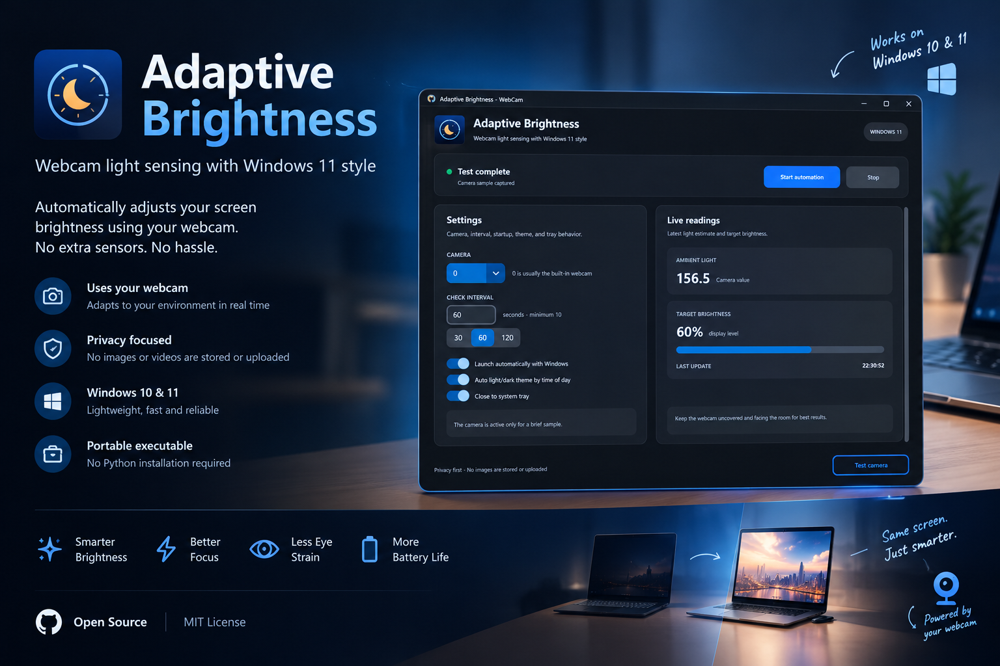

# Adaptive Brightness Webcam

<p align="center">
  
</p>

<p align="center">
  <strong>Comfortable screen brightness, automatically tuned to your room.</strong><br>
  A lightweight Windows app that uses short webcam light samples to adjust display brightness.
</p>

<p align="center">
  <a href="https://github.com/Arman-Kohan/adaptive-brightness-webcam/releases"></a>
  <a href="https://github.com/Arman-Kohan/adaptive-brightness-webcam/actions/workflows/build-check.yml"></a>
  <a href="https://github.com/Arman-Kohan/adaptive-brightness-webcam/blob/main/LICENSE"></a>
  <a href="https://github.com/Arman-Kohan/adaptive-brightness-webcam"></a>
</p>

<p align="center">
  <a href="README.fa.md">راهنمای فارسی</a>
  ·
  <a href="https://github.com/Arman-Kohan/adaptive-brightness-webcam/releases">Download</a>
  ·
  <a href="https://github.com/Arman-Kohan/adaptive-brightness-webcam/issues">Suggest an improvement</a>
</p>

## Why Adaptive Brightness Webcam?

Most automatic brightness tools either depend on a dedicated light sensor or react too aggressively to noisy camera readings. This project takes a calmer approach: it samples the webcam briefly, analyzes the scene, filters unstable measurements, and changes brightness only when the result is meaningful.

The result is a small, privacy-conscious utility that is especially useful on Windows laptops with built-in displays.

## Highlights

- **Automatic brightness control** based on short webcam samples.
- **Two sampling modes:** keep a predictable fixed interval or use Smart Adaptive mode, which schedules its own measurements.
- **Persistent settings:** camera, mode, interval, theme, and tray preferences are saved to `%APPDATA%\Adaptive Brightness Webcam\settings.json` and restored on every launch.
- **Privacy first:** frames are processed in memory; no images or videos are saved or uploaded.
- **Stable transitions:** median sampling, exposure calibration, smoothing, deadband, hysteresis, and gradual brightness ramps reduce flicker.
- **Scene-aware measurement:** analyzes the center 80% of the frame, luminance percentiles, contrast, highlights, and dim-scene behavior.
- **Simple desktop UI:** test the camera, start or stop automation, and see the latest light estimate and target brightness.
- **System tray support:** keep automation running quietly in the background.
- **Windows startup option:** launch automatically when you sign in.
- **Power-aware behavior:** checks are spaced out further on battery to reduce webcam wakeups.
- **Light and dark appearance:** follow the Windows theme or switch automatically between day and night.
- **Portable release:** download and run the Windows executable without installing Python.

## Download and run

1. Open the [latest Releases](https://github.com/Arman-Kohan/adaptive-brightness-webcam/releases).
2. Download `AdaptiveBrightnessWebcam.exe`, or download `AdaptiveBrightnessWebcam-Windows.zip` for the portable package.
3. Extract the ZIP if necessary and run `AdaptiveBrightnessWebcam.exe`.
4. Choose the webcam index. `Camera 0` is usually the built-in webcam.
5. Click **Test camera**, choose a sampling mode, and click **Start automation**.

No Python installation, administrator privileges, or installer is required for the packaged release.

### Recommended first setup

For a comfortable starting point:

- Keep the webcam uncovered and pointed toward the room.
- Avoid pointing it directly at a lamp or a bright window.
- New installations start with **Smart Adaptive**, which checks frequently while your lighting is changing and backs off to sparse checks (up to two minutes apart) when the room is stable — there are no interval limits to configure. **Fixed Interval** remains available with its existing 120-second default.
- Use **Test camera** before starting automation.
- If you use an external monitor, verify that it supports Windows brightness control.

## How it works

For each check, the app:

1. Opens the selected webcam through OpenCV and DirectShow.
2. Lets the camera warm up briefly so auto-exposure can settle.
3. Captures five valid samples and uses the median measurement.
4. Analyzes the center 80% of the frame using luminance percentiles (`p25`, `p50`, `p75`, `p90`).
5. Accounts for scene contrast, near-white highlights, supported exposure values, and dim-scene patterns.
6. Maps the result through a configurable comfort curve.
7. Applies smoothing and hysteresis to avoid flicker.
8. Sends the target to Windows with `powercfg`; larger changes are ramped gradually.
9. In Fixed Interval mode, releases the webcam immediately after sampling. In Smart Adaptive mode, keeps one camera session open for the whole run so the webcam is not restarted for every check, and releases it when automation stops.

In **Smart Adaptive** mode, `AdaptiveSamplingController` schedules every
measurement autonomously — there are no user-configured interval limits. It
keeps a short history of valid observations, filters the signal with an EMA,
estimates camera noise with a rolling median/MAD, and tracks the robust
(Theil–Sen) rate of change. When light is changing rapidly, or the current
brightness is far from the desired one, the interval drops to the internal
5-second minimum and stays there for confirmation samples; when consecutive
observations prove the room is stable, the interval grows geometrically up to
the internal 120-second maximum, so a stable room is checked only a few dozen
times an hour. A sudden change that happens just after a sample is therefore
detected within at most 120 seconds and then re-checked every 5 seconds until
the new level settles. Invalid samples never enter the history.

Brightness changes in Smart Adaptive mode also pass through
`BrightnessChangeGate`: the first measurements after Start are a
stabilization period (nothing is applied), insignificant changes inside the
deadband are ignored, moderate changes need confirmation from consecutive
samples, successive changes are rate- and magnitude-limited, and only large
changes apply immediately. Together with the camera session this makes Smart
Adaptive calm: no camera restart flicker and no brightness hunting.
Fixed Interval mode bypasses the scheduler and gate and retains the existing
scheduling behavior.

The displayed camera value is a relative, camera-derived luminance estimate—not a physical lux measurement. Different cameras, framing, exposure, and white balance can produce different values in the same room.

## Settings

| Setting | What it does |
|---|---|
| **Camera** | Selects the webcam index used for sampling. |
| **Sampling mode** | **Fixed Interval** preserves a user-selected schedule. **Smart Adaptive** schedules measurements automatically (internal 5–120 second bounds) based on lighting stability and rate of change. |
| **Check interval** | Fixed Interval schedule. Minimum: 30 seconds. The default is 120 seconds. This control is shown only in Fixed Interval mode. |
| **Settings file** | Camera, sampling mode, fixed interval, theme, and tray preferences persist in `%APPDATA%\Adaptive Brightness Webcam\settings.json` and are restored automatically on launch. Corrupted files fall back to defaults; interval keys written by older versions are ignored. |
| **Appearance** | **Auto** follows day/night; **Windows** follows the system theme. |
| **Launch with Windows** | Starts the app automatically when you sign in. |
| **Close to tray** | Hides the window while leaving the app running in the system tray. |

When running on battery, Fixed Interval mode automatically increases the effective wait between checks. Smart Adaptive mode uses its internal interval bounds directly so a sudden change is not delayed by a second, hidden multiplier. Smart Adaptive also shows the current interval, stability state, trend, and whether the next wait is increasing or decreasing.

## Privacy and compatibility

- The webcam is active only during a short warm-up and sampling window. The camera privacy indicator may turn on during that time.
- The DirectShow backend may not honor OpenCV's optional read-timeout property; capture is released after each sample, but a device driver that blocks inside `read()` can still delay shutdown until the driver returns.
- Frames are processed in memory and are not saved, uploaded, or transmitted by this application.
- Diagnostic logs are written to `%USERPROFILE%\.adaptive-brightness-webcam.log`.
- Brightness control works best with internal laptop displays.
- Some external monitors, docks, virtual displays, and vendor-specific drivers do not expose brightness control through Windows.
- The app requires Windows 10/11, a camera permission, a valid webcam index, and a display that accepts the Windows `powercfg` brightness commands.

## Troubleshooting

### The camera test fails

Try camera index `1` or `2`, check Windows camera permissions, and close other apps that may be using the webcam. The selected camera must be available through the DirectShow backend.

### Brightness does not change

Many external monitors do not accept software brightness commands from Windows. Check the display's hardware controls or vendor software, then inspect `%USERPROFILE%\.adaptive-brightness-webcam.log` for `powercfg` errors.

### The response is too slow or too bright

Reduce the fixed interval, make sure the camera is facing the room, and adjust `BrightnessConfig` in `adaptive_brightness.py`. Fixed Interval battery mode intentionally adds extra delay; Smart Adaptive uses its internal bounds. The brightness curve is calibrated so an ambient reading of about 170.9 maps to 57% brightness.

## Manual webcam validation

These checks require a real Windows webcam and display. They are not part of the
automated test suite, and passing them depends on camera exposure behavior,
lighting, and whether the display accepts Windows brightness commands.

1. Select the webcam, click **Test camera**, and confirm that a numeric ambient
   value and target brightness are shown. Check that the camera privacy indicator
   turns off after the short sample.
2. Select **Smart Adaptive**, start automation, and leave the room stable
   for at least 10 minutes. Confirm that the diagnostic interval grows toward
   120 seconds, the camera LED stays on (one session, no repeated restarts),
   and brightness does not change during the first stabilization samples.
3. Move from a dark room into a bright room, then repeat from bright to dark.
   Confirm that the next reading changes the target and that the displayed
   interval falls to 2 seconds for confirmation samples before growing again.
4. Turn room lights off and on several times. Confirm meaningful brightness
   changes occur without rapid oscillation from camera noise.
5. During gradual daylight change, record the displayed ambient value, trend,
   stability state, and interval every few minutes. Confirm the values move
   smoothly rather than jumping on every exposure adjustment.
6. Pass a hand or object briefly in front of the camera. Confirm that a
   short-lived shadow may be missed when the camera is sleeping, but if sampled
   it does not leave the controller stuck at the minimum interval.
7. Disconnect or disable the camera while automation is running, then restore
   it. Confirm the app reports a camera warning, remains responsive, and resumes
   sampling after the device becomes available.
8. While running, switch between **Fixed Interval** and **Smart Adaptive**.
   The current run stops explicitly; start automation again to apply the newly
   selected mode. Verify Fixed Interval retains its configured value, then
   close and relaunch the app and confirm camera, mode, and interval are
   restored from the settings file.
9. Repeat the stable-lighting check on AC power and battery power. Fixed
   Interval applies its existing battery delay; Smart Adaptive uses its own
   internal bounds without an additional battery multiplier.

## For developers

### Requirements

- Windows 10 or Windows 11
- Python 3.10+ recommended
- A webcam supported by OpenCV

### Run from source

```powershell
python -m pip install -r requirements.txt
python app.py
```

Run the controller without the graphical interface in Fixed Interval mode:

```powershell
python adaptive_brightness.py --camera 0 --mode fixed --interval 120
```

Run the controller with adaptive sampling:

```powershell
python adaptive_brightness.py --camera 0 --mode smart
```

The CLI defaults to Smart Adaptive mode. Use `--mode fixed` explicitly when
you want the fixed schedule and its 120-second default. The old
`--minimum-interval` / `--maximum-interval` flags are still accepted for
backwards compatibility but are ignored: Smart Adaptive has no
user-configured interval limits.

Take one sample and exit:

```powershell
python adaptive_brightness.py --camera 0 --once
```

Run the tests:

```powershell
python -m unittest discover -s tests -p "test_*.py"
```

Build the Windows executable:

```powershell
.\build.ps1
```

The build produces `dist\AdaptiveBrightnessWebcam.exe`. The release workflow packages the executable and portable ZIP whenever a `v*` tag is pushed.

## Contributing and feedback

Found a bug, have a calibration idea, or want support for another display or camera setup? Please [open an issue](https://github.com/Arman-Kohan/adaptive-brightness-webcam/issues) with:

- Windows version and display type
- Camera model or camera index
- What you expected and what happened
- Relevant log output, with any private information removed

If this project is useful to you, consider leaving a **star** on GitHub. It helps the project become more visible and motivates future improvements.

## License

Released under the [MIT License](LICENSE).
